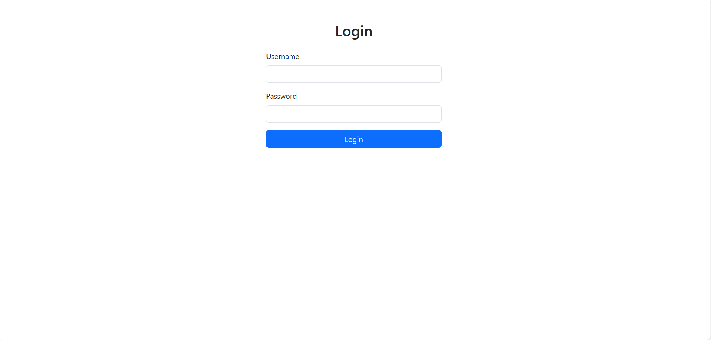
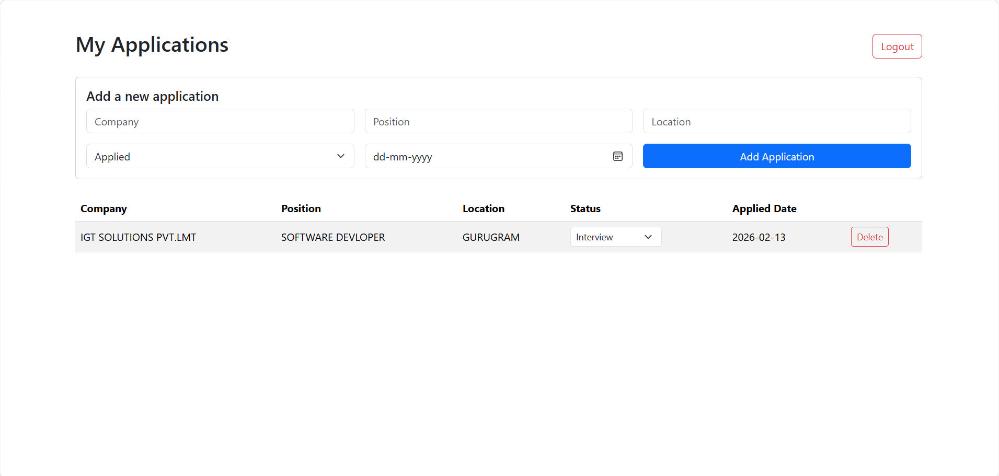

# Job Application Tracker

A full stack web app to track job applications through each stage: Applied, Interview, Offer, and Rejected. Each application can also have notes.

## Screenshots

### Login


### Dashboard


## Tech Stack

- **Backend:** Python, Django, Django REST Framework
- **Authentication:** JWT (SimpleJWT) with automatic token refresh
- **Databases:** SQL (SQLite) for applications and users, MongoDB for notes
- **Frontend:** React (Vite), React Router, Axios, Bootstrap

## Why two databases?

Applications have a fixed structure (company, position, status, date) and belong to a user, so they fit a SQL table with relationships. Notes are free-form text that can grow over time, so they are stored as flexible documents in MongoDB, linked to an application by its id.

## Features

- Secure login with JWT tokens
- Add job applications from a form
- Change the status of an application (Applied, Interview, Offer, Rejected)
- Delete applications
- Add notes to any application (stored in MongoDB)
- Each user only sees their own applications and notes
- Access token refreshes automatically when it expires
- Django admin panel to manage data

## API Endpoints

| Method | Endpoint | Description |
|--------|----------|-------------|
| POST | `/api/token/` | Log in and get tokens |
| POST | `/api/token/refresh/` | Get a new access token |
| GET | `/api/applications/` | List your applications |
| POST | `/api/applications/` | Add an application |
| PUT/PATCH | `/api/applications/<id>/` | Update an application |
| DELETE | `/api/applications/<id>/` | Delete an application |
| GET | `/api/applications/<id>/notes/` | List notes for an application |
| POST | `/api/applications/<id>/notes/` | Add a note to an application |

## Project Structure

```
JobTracker/
├── backend/      Django REST API
├── frontend/     React app
└── screenshots/  Images for this README
```

## How to Run

You need MongoDB running locally on `mongodb://localhost:27017`, plus two terminals, one for the backend and one for the frontend.

### 1. Backend (Terminal 1)

```bash
cd backend
python -m venv venv
venv\Scripts\activate
pip install django djangorestframework django-cors-headers djangorestframework-simplejwt pymongo
python manage.py migrate
python manage.py createsuperuser
python manage.py runserver
```

### 2. Frontend (Terminal 2)

```bash
cd frontend
npm install
npm run dev
```

Open http://localhost:5173 and log in with the superuser you created.

## Author

Tauseef Ekhlaque